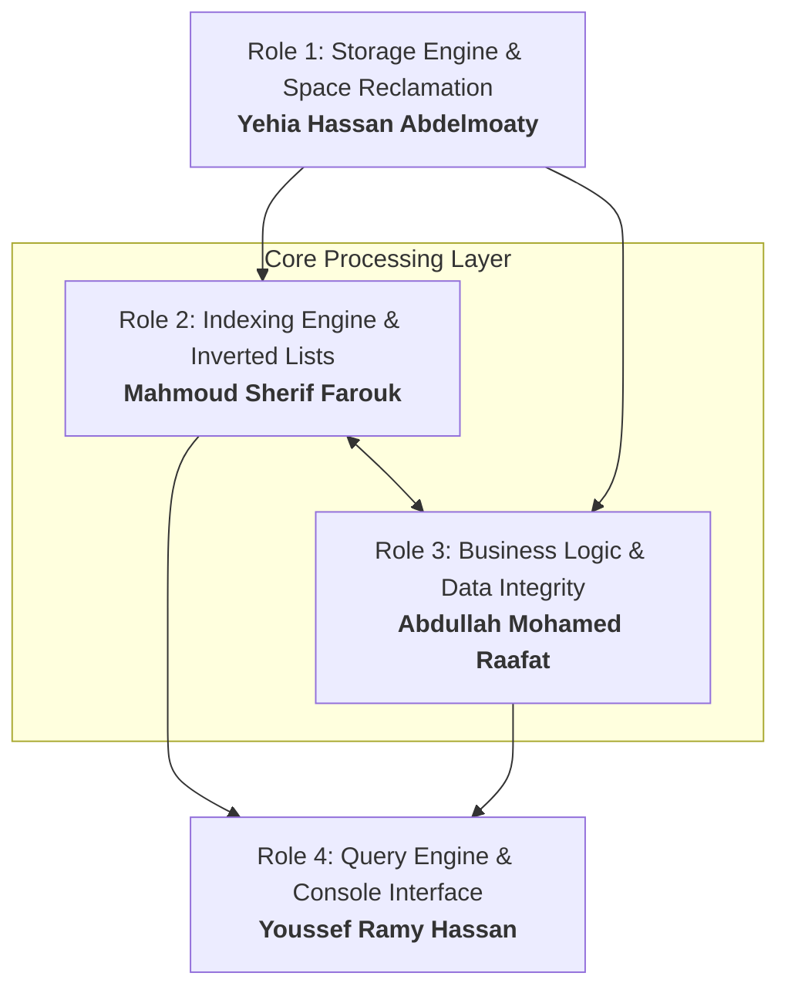

# ASSIGNMENT COVER PAGE & PROJECT README
# Healthcare Management System (IS321)

**Course:** File Management and Processing (IS321)  
**Academic Year:** 2026 / 2027  
**Assignment:** Assignment 1 Healthcare Management System  
**Submission Weight:** 10 Points  
**Teaching Assistant (TA) Name:** Nesma  
**Lab / Section:** S1, S2  

---

## 👥 Team Information & Member Roles (Group of 4)

| # | Student Name | Student ID | Assigned Role | Core Responsibilities |
|:---:|:---|:---:|:---:|:---|
| **1** | Yehia Hassan Abdelmoaty | 20242447 | **Role 1** | Storage Engine & Space Reclamation (Avail List) |
| **2** | Mahmoud Sherif Farouk | 20240552 | **Role 2** | Indexing Engine & Inverted Lists (Binary Search & Late Binding) |
| **3** | Abdullah Mohamed Raafat | 20240328 | **Role 3** | Business Logic, CRUD Operations & Data Integrity |
| **4** | Youssef Ramy Hassan | 20240689 | **Role 4** | Query Engine (SQL Parser, Set Intersection) & Console Interface |

---

## 📋 Submission Checklist

- [ ] Fixed-length binary records for Doctors (95 bytes) and Appointments (60 bytes)
- [ ] 4-byte header representing AVAIL LIST head offset (`-1` when empty)
- [ ] Logical deletion marking with `'*'` and Avail List chaining
- [ ] Primary indexes sorted ascending with Binary Search
- [ ] Primary key update using array shifting
- [ ] Secondary indexes using linked list on a separate file technique (Folk & Zoellick Figure 7.13)
- [ ] SQL-like query engine supporting single and compound (`AND`) queries
- [ ] Initial dataset of 5 Doctors and 10 Appointments pre-populated
- [ ] All team members prepared for oral discussion

---

## 📌 Project Brief

This project implements an indexed **Healthcare Management System** in C++ designed to manage doctors and patient appointments without relying on external databases. The system builds a low-level storage engine, custom indexing tables, and a mini query engine adhering to core file management principles:

### Core File Specifications
* **Fixed-Length Records**:
  * `Doctors Data File` (`doctors.bin`): **95 bytes** per record (`Doctor ID [15]`, `Doctor Name [30]`, `Doctor Specialty [20]`, `Address [30]`).
  * `Appointments Data File` (`appointments.bin`): **60 bytes** per record (`Appointment ID [15]`, `Appointment Date [30]`, `Doctor ID [15]`).
* **Dynamic Space Reclamation (AVAIL LIST)**:
  * A 4-byte header integer (`sizeof(int)`) at the beginning of each file stores the byte offset of the Avail List head (`-1` initially).
  * Deleted records are logically deleted using the `'*'` marker and chained into a LIFO stack. Newly inserted records reuse freed slots before growing the file.
* **Primary Indexing & Binary Search**:
  * Sorted primary index arrays in memory provide $O(\log N)$ lookups via **Binary Search**.
  * Array element shifting is used to maintain sorted order on insertions, deletions, and Primary Key updates.
* **Secondary Indexing via Inverted Lists on Separate Files**:
  * Implements **Folk & Zoellick (Chapter 7, Figure 7.13)**: secondary index tables point to head nodes in separate inverted linked list binary files (`*_ll.bin`).
  * **Late Binding**: Secondary index entries bind to **Primary Keys** (not physical byte offsets) to insulate indexes from file reorganizations.
* **Query Engine with Set Intersection**:
  * Parses SQL-like statements (`Select ... where ...`).
  * Multi-attribute queries (e.g. `WHERE Name='x' AND Specialty='y'`) compute the mathematical **Set Intersection ($A \cap B$)** across secondary indexes before fetching matching records.

---

## 🏗️ System Architecture

---

## 📂 Documentation

Detailed proposals, metrics, and assignment specifications are organized inside the [`docs/`](docs/) directory:

* 📄 [**Team Work Division & Architecture Proposal**](docs/TEAM_WORK_DIVISION.md): Detailed 4-member modular breakdown, LOC estimates, and class structure.
* 📄 [**Assignment Specification Sheet (PDF)**](docs/IS321_Assignment_1_Healthcare_System.pdf): The official course handout and problem requirements.
* 📄 [**System Testing, UI Evaluation & Validation Report**](docs/SYSTEM_TESTING_AND_VALIDATION.md): Comprehensive test matrix, real execution traces, and edge-case failure testing results.
