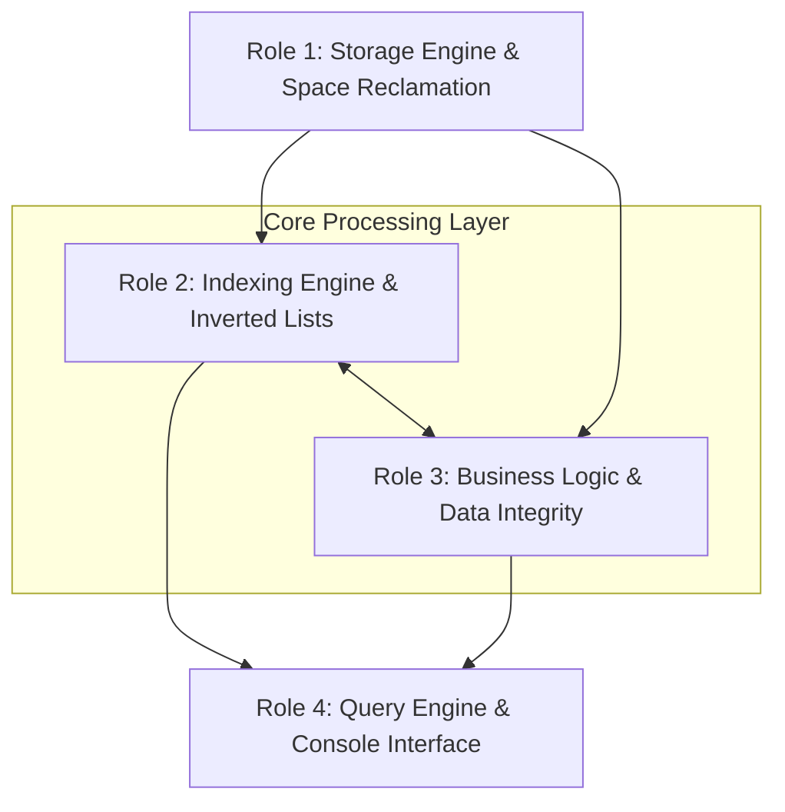
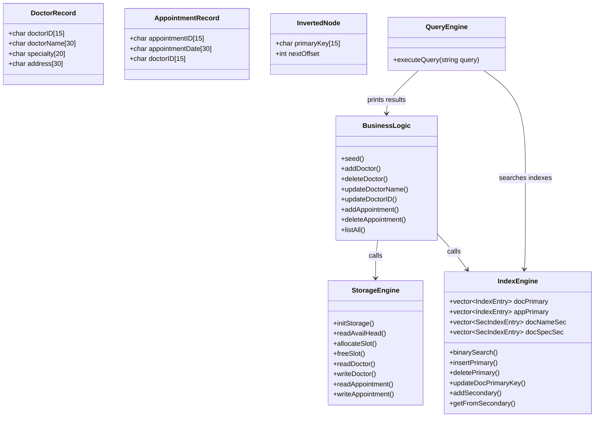

# Project Proposal: Healthcare Management System (IS321)
## 4-Member Work Division & System Architecture Plan

---

## 1. System Overview & Core Objectives

This project implements an indexed **Healthcare Management System** in C++ using raw binary files, custom indexing, space reclamation, and a custom query engine.

### Key Data Specifications
* **Doctors Data File (`doctors.bin`)**: Fixed-length records, **95 bytes** each:
  * `Doctor ID`: `char[15]` (Primary Key)
  * `Doctor Name`: `char[30]` (Secondary Key)
  * `Doctor Specialty`: `char[20]` (Secondary Key)
  * `Address`: `char[30]` (Non-Key Attribute)
* **Appointments Data File (`appointments.bin`)**: Fixed-length records, **60 bytes** each:
  * `Appointment ID`: `char[15]` (Primary Key)
  * `Appointment Date`: `char[30]` (Non-Key Attribute)
  * `Doctor ID`: `char[15]` (Secondary Key / Foreign Key)
* **Header Record**: The first 4 bytes (`sizeof(int)`) of each data file store the byte offset of the **AVAIL LIST** head (`-1` initially).

---

## 2. System Architecture

---

## 3. Proposed 4-Member Work Division & Metrics

The project is partitioned into 4 balanced, loosely coupled modules so each member can work independently with minimal merge conflicts.

---

### Role 1: Storage Engine & Space Reclamation (Avail List)

#### Metrics
* **Grade Weight Contribution**: `~25% (2.5 / 10 Points)`
* **Estimated Size Range**: `90 – 120 LOC`
* **Assigned Files**:
  * `include/Models.h` *(Shared record structures)*
  * `include/StorageEngine.h`
  * `src/StorageEngine.cpp`
* **Complexity Level**: `Medium`

#### Responsibilities
1. **Record Layout & Memory Packing**:
   * Define byte-exact structures for `DoctorRecord` (95 bytes) and `AppointmentRecord` (60 bytes) using `#pragma pack(push, 1)`.
   * Implement fixed-size string padding (spaces/nulls) and trim utilities.
2. **Header Management**:
   * Initialize data files with a 4-byte integer header (`-1` when empty).
   * Read and write the Avail List head offset at byte 0.
3. **Space Reclamation (AVAIL LIST)**:
   * **Allocation (`allocateSlot`)**: If the Avail List is not empty, pop the top deleted slot, read its next pointer, update the header, and return the slot offset. If empty, append to the end of the file.
   * **Deallocation (`freeSlot`)**: Logically delete the record by placing the `'*'` marker at byte 0, write the previous Avail List head inside the record, and update the file header to point to this newly freed slot.
4. **Binary I/O Operations**:
   * Low-level read, write, and in-place field update routines for both Doctors and Appointments.

---

### Role 2: Indexing Engine & Inverted Lists

#### Metrics
* **Grade Weight Contribution**: `~25% (2.5 / 10 Points)`
* **Estimated Size Range**: `130 – 160 LOC`
* **Assigned Files**:
  * `include/IndexEngine.h`
  * `src/IndexEngine.cpp`
* **Complexity Level**: `Medium – High`

#### Responsibilities
1. **Primary Indexing (In-Memory)**:
   * Maintain sorted ascending arrays/vectors of `(Key, ByteOffset)` for Doctors and Appointments.
   * Implement **Binary Search** ($O(\log N)$) returning the record position or `-1`.
2. **Array Shifting on Primary Key Updates**:
   * Insert new keys into the primary index using element shifting to maintain sorted order.
   * Remove keys using left-shifting.
   * On Primary Key updates, handle rearrangement via shifting rather than full re-sorting.
3. **Secondary Indexing (Inverted List on File)**:
   * Maintain secondary index tables: `(Secondary Key, Head Node Pointer)`.
   * Manage the separate inverted list binary file containing nodes: `InvertedNode { PrimaryKey [15], NextPointer [int] }`.
   * **Late Binding**: Secondary index records bind to the Primary Key (not physical byte offsets).
   * Implement list traversal to gather all Primary Keys associated with a given secondary key.

---

### Role 3: Business Logic & Data Integrity

#### Metrics
* **Grade Weight Contribution**: `~25% (2.5 / 10 Points)`
* **Estimated Size Range**: `100 – 130 LOC`
* **Assigned Files**:
  * `include/BusinessLogic.h`
  * `src/BusinessLogic.cpp`
* **Complexity Level**: `Medium`

#### Responsibilities
1. **Data Initialization (Seeding)**:
   * Automatically pre-populate the initial dataset of **5 Doctors and 10 Appointments** on first boot.
2. **High-Level CRUD Operations**:
   * **Add**: Reject duplicate primary keys; request an offset from Role 1; write record; register keys in Role 2's primary and secondary indexes.
   * **Delete**: Verify existence via primary index; instruct Role 1 to free the slot into the Avail List; remove entries from Role 2's indexes.
   * **Update**: Perform in-place updates for non-key attributes (e.g. Doctor Name, Appointment Date) and propagate key changes.
3. **Foreign Key Integrity**:
   * Enforce relational integrity: verify that a `Doctor ID` exists in the Doctor Primary Index before scheduling an Appointment.
4. **Display Helpers**:
   * Implement record retrieval, formatted printing, and table listing for all registered entities.

---

### Role 4: Query Engine & User Interface

#### Metrics
* **Grade Weight Contribution**: `~25% (2.5 / 10 Points)`
* **Estimated Size Range**: `90 – 120 LOC`
* **Assigned Files**:
  * `include/QueryEngine.h`
  * `src/QueryEngine.cpp`
  * `src/main.cpp`
* **Complexity Level**: `Medium`

#### Responsibilities
1. **SQL-like Query Parser**:
   * Parse single-key queries:
     * `Select all from Doctors where Doctor ID='xxx';` *(Direct Binary Search on Primary Index)*
     * `Select all from Appointments where Doctor ID='xxx';` *(Secondary Index lookup)*
     * `Select Doctor Name from Doctors where Doctor Name='xxx';` *(Secondary Index lookup)*
2. **Multi-Index Set Intersection (Boolean `AND`)**:
   * Parse compound queries:  
     `Select all from Doctors where Doctor Name='xxx' and Doctor Specialty='yyy';`
   * Retrieve candidate ID lists from both secondary index inverted files.
   * Compute mathematical **Set Intersection ($A \cap B$)** in memory, then retrieve matching records via the Primary Index.
3. **Console Interface & Workflow**:
   * Interactive menu offering full management options (Add, Update, Delete, Print, Query, List All).
4. **Avail List Lifecycle Test**:
   * An automated demonstration option verifying the complete lifecycle of space reclamation: adding records, deleting a record (verifying header update), and inserting a new record into the recycled slot.

---

## 4. Class & Data Structure Hierarchy

---

## 5. Metrics & Workload Summary Table

| Metric | Role 1 (Storage) | Role 2 (Indexing) | Role 3 (Business Logic) | Role 4 (Query & UI) | Shared | Total |
| :--- | :---: | :---: | :---: | :---: | :---: | :---: |
| **Grade Contribution** | ~25% (2.5 pts) | ~25% (2.5 pts) | ~25% (2.5 pts) | ~25% (2.5 pts) | — | **10.0 pts** |
| **Estimated LOC Range** | 90 – 120 | 130 – 160 | 100 – 130 | 90 – 120 | 30 – 40 | **450 – 550** |
| **Complexity** | Medium | Medium-High | Medium | Medium | Low | **Balanced** |
| **Primary Domain** | Disk I/O & Avail List | Binary Search & Inverted Lists | CRUD & Integrity | Parsing & UI | Structs | **Full System** |